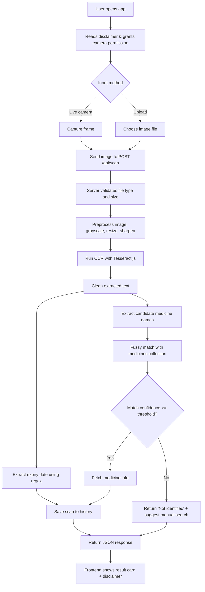

# 💊 AI Medicine Information Detector

A MERN-stack mini project that reads a medicine package through the camera (or an uploaded photo) and displays **general information** about it: name, general use, basic precautions, and expiry date (if readable).

> ⚠️ **Disclaimer:** This is an **information/reading tool only**. It does **not** diagnose, prescribe, recommend, or suggest dosage. It never tells a user which medicine to take. Always consult a doctor or pharmacist before taking any medicine.

---

## 📑 Table of Contents

1. [Project Overview](#1-project-overview)
2. [Features](#2-features)
3. [What the App Will NOT Do](#3-what-the-app-will-not-do)
4. [Tech Stack](#4-tech-stack)
5. [System Architecture](#5-system-architecture)
6. [Detailed Application Flow](#6-detailed-application-flow)
7. [Folder Structure](#7-folder-structure)
8. [Database Design](#8-database-design)
9. [API Documentation](#9-api-documentation)
10. [Core Logic (OCR, Matching, Expiry)](#10-core-logic)
11. [Setup & Installation](#11-setup--installation)
12. [Environment Variables](#12-environment-variables)
13. [Seeding Medicine Data](#13-seeding-medicine-data)
14. [Testing Plan](#14-testing-plan)
15. [Limitations](#15-limitations)
16. [Future Scope](#16-future-scope)
17. [Development Timeline](#17-suggested-development-timeline)
18. [Team & License](#18-team--license)

---

## 1. Project Overview

| Item | Details |
|---|---|
| **Project name** | AI Medicine Information Detector |
| **Type** | Student mini project |
| **Stack** | MongoDB, Express.js, React.js, Node.js (MERN) |
| **Input** | Live camera frame or uploaded image of a medicine package |
| **Output** | Medicine name, general use, basic precautions, expiry date |
| **Purpose** | Help users quickly read and understand basic info printed on / associated with a medicine package |

**Problem:** Medicine packages have small, dense text. Many people (elderly users, students, caregivers) struggle to read names, uses, and expiry dates.

**Solution:** Point the camera at the package → the app extracts text with OCR → matches it with a medicine database → shows clear, simple information.

---

## 2. Features

- 📷 Live camera capture (webcam / phone camera) and image upload fallback
- 🔤 OCR-based text extraction from the package
- 🔍 Fuzzy matching of extracted text against a medicine database
- 📋 Display of:
  - Medicine name (brand + generic/salt name)
  - General purpose / use
  - Basic precautions
  - Expiry date (if readable) with status: ✅ Valid / ⚠️ Expiring soon / ❌ Expired
- 🕘 Scan history (stored in MongoDB)
- 🔎 Manual search by medicine name (backup when OCR fails)
- ⚖️ Clear medical disclaimer on every result
- 📱 Responsive UI

---

## 3. What the App Will NOT Do

To keep the project safe and ethical:

- ❌ No dosage recommendations
- ❌ No "take this medicine for your symptoms" suggestions
- ❌ No diagnosis
- ❌ No replacement for a doctor or pharmacist
- ❌ No guarantee of correct identification (OCR can fail)

---

## 4. Tech Stack

| Layer | Technology |
|---|---|
| **Frontend** | React.js (Vite), Axios, React Router, `react-webcam`, Tailwind CSS / Material UI |
| **Backend** | Node.js, Express.js, Multer (image upload), Sharp (image preprocessing), Helmet, CORS, express-rate-limit |
| **Database** | MongoDB + Mongoose |
| **OCR / AI** | Tesseract.js (free, offline OCR) |
| **Matching** | Fuse.js (fuzzy search) |
| **Optional AI upgrade** | Vision LLM API (e.g. Gemini / Claude vision) as a fallback for hard-to-read packages |
| **Data source** | Custom seed JSON (curated) — optionally enriched from openFDA / public drug datasets |
| **Dev tools** | Postman, Git/GitHub, ESLint, Nodemon |

---

## 5. System Architecture

```
┌─────────────────────────┐
│        React Client      │
│  - Camera / Upload UI    │
│  - Result Card           │
│  - History / Search      │
└────────────┬────────────┘
             │ HTTP (REST / JSON, multipart image)
             ▼
┌─────────────────────────┐
│   Express.js Server      │
│  ┌───────────────────┐  │
│  │ Upload Middleware │  │  (Multer)
│  ├───────────────────┤  │
│  │ Image Preprocess  │  │  (Sharp: grayscale, resize, sharpen)
│  ├───────────────────┤  │
│  │ OCR Service       │  │  (Tesseract.js)
│  ├───────────────────┤  │
│  │ Text Parser       │  │  (clean text, extract candidate names, expiry regex)
│  ├───────────────────┤  │
│  │ Matching Service  │  │  (Fuse.js against MongoDB data)
│  └───────────────────┘  │
└────────────┬────────────┘
             │ Mongoose
             ▼
┌─────────────────────────┐
│        MongoDB           │
│  - medicines             │
│  - scans (history)       │
└─────────────────────────┘
```

---

## 6. Detailed Application Flow

### 6.1 Main Scan Flow



### 6.2 Step-by-Step Description

1. **Open app** – user sees a short disclaimer and a "Scan Medicine" button.
2. **Capture** – user shows the package to the camera and clicks *Capture* (or uploads an image).
3. **Upload to server** – image is sent as `multipart/form-data` to `POST /api/scan`.
4. **Validation** – server checks MIME type (`jpeg/png/webp`) and size (≤ 5 MB).
5. **Preprocessing** – image is converted to grayscale, resized, and sharpened to improve OCR accuracy.
6. **OCR** – Tesseract.js extracts raw text from the image.
7. **Parsing**
   - Clean text (remove noise, lowercase, trim).
   - Extract **expiry date** using regex patterns (`EXP 08/2027`, `Expiry: 12-2026`, etc.).
   - Extract **candidate names** (longest meaningful words / lines).
8. **Matching** – Fuse.js compares candidates with medicine names and generic names in MongoDB; returns the best match and a confidence score.
9. **Response** – server returns medicine info + expiry status + confidence.
10. **Display** – React shows the result card with a disclaimer. If confidence is low, the UI shows "Could not identify confidently" and offers manual search / re-scan.
11. **History** – each scan is saved (without storing the image, for privacy).

### 6.3 Manual Search Flow (Fallback)

```
User types medicine name → GET /api/medicines/search?q=para
→ list of suggestions → user selects → GET /api/medicines/:id → show info card
```

### 6.4 Frontend Page Flow

```
Home ──► Scan Page ──► Result Page ──► (Scan Again / Save)
  │
  ├──► Search Page ──► Medicine Details Page
  └──► History Page
```

---

## 7. Folder Structure

```
medicine-info-detector/
│
├── client/                         # React frontend
│   ├── public/
│   ├── src/
│   │   ├── components/
│   │   │   ├── CameraCapture.jsx
│   │   │   ├── ImageUpload.jsx
│   │   │   ├── ResultCard.jsx
│   │   │   ├── ExpiryBadge.jsx
│   │   │   ├── Disclaimer.jsx
│   │   │   ├── SearchBar.jsx
│   │   │   └── Loader.jsx
│   │   ├── pages/
│   │   │   ├── Home.jsx
│   │   │   ├── Scan.jsx
│   │   │   ├── Result.jsx
│   │   │   ├── Search.jsx
│   │   │   └── History.jsx
│   │   ├── services/
│   │   │   └── api.js              # Axios instance
│   │   ├── utils/
│   │   │   └── dateUtils.js
│   │   ├── App.jsx
│   │   └── main.jsx
│   └── package.json
│
├── server/                         # Node + Express backend
│   ├── config/
│   │   └── db.js
│   ├── controllers/
│   │   ├── scanController.js
│   │   └── medicineController.js
│   ├── middleware/
│   │   ├── upload.js               # Multer config
│   │   └── errorHandler.js
│   ├── models/
│   │   ├── Medicine.js
│   │   └── Scan.js
│   ├── routes/
│   │   ├── scanRoutes.js
│   │   └── medicineRoutes.js
│   ├── services/
│   │   ├── imageService.js         # Sharp preprocessing
│   │   ├── ocrService.js           # Tesseract.js
│   │   ├── parserService.js        # text cleaning + expiry regex
│   │   └── matchService.js         # Fuse.js matching
│   ├── data/
│   │   └── medicines.seed.json
│   ├── scripts/
│   │   └── seed.js
│   ├── server.js
│   ├── .env.example
│   └── package.json
│
├── docs/
│   ├── screenshots/
│   └── report.pdf
│
├── .gitignore
└── README.md
```

---

## 8. Database Design

### 8.1 `medicines` collection

```js
// server/models/Medicine.js
const medicineSchema = new mongoose.Schema({
  brandNames:   { type: [String], required: true, index: true }, // e.g. ["Crocin", "Dolo 650"]
  genericName:  { type: String, required: true, index: true },   // e.g. "Paracetamol"
  category:     { type: String },                                // e.g. "Analgesic / Antipyretic"
  generalUse:   { type: String, required: true },                // plain-language purpose
  precautions:  { type: [String], default: [] },                 // basic precautions
  storage:      { type: String },                                // optional
  source:       { type: String },                                // data source / reference
  keywords:     { type: [String], default: [] },                 // extra OCR matching keywords
}, { timestamps: true });
```

**Sample document**

```json
{
  "brandNames": ["Crocin", "Dolo"],
  "genericName": "Paracetamol",
  "category": "Analgesic / Antipyretic",
  "generalUse": "Commonly used to relieve mild pain and reduce fever.",
  "precautions": [
    "Do not exceed the dose mentioned on the label or by your doctor.",
    "Consult a doctor if you have liver problems.",
    "Avoid taking multiple products that contain paracetamol together.",
    "Keep out of reach of children."
  ],
  "storage": "Store in a cool, dry place away from sunlight."
}
```

### 8.2 `scans` collection (history)

```js
const scanSchema = new mongoose.Schema({
  extractedText:  String,
  matchedMedicine:{ type: mongoose.Schema.Types.ObjectId, ref: "Medicine" },
  confidence:     Number,           // 0–1
  expiryDate:     Date,             // null if not readable
  expiryStatus:   { type: String, enum: ["valid", "expiring_soon", "expired", "unknown"] },
  createdAt:      { type: Date, default: Date.now }
});
```

> 🔒 **Privacy:** Uploaded images are processed in memory/temp storage and deleted immediately. Only extracted text and results are stored.

---

## 9. API Documentation

Base URL: `http://localhost:5000/api`

### `POST /scan`
Upload an image and get medicine info.

- **Content-Type:** `multipart/form-data`
- **Field:** `image` (file)

**Success response (200)**
```json
{
  "success": true,
  "identified": true,
  "confidence": 0.86,
  "medicine": {
    "_id": "665f...",
    "name": "Paracetamol",
    "brandNames": ["Crocin", "Dolo"],
    "generalUse": "Commonly used to relieve mild pain and reduce fever.",
    "precautions": ["..."]
  },
  "expiry": {
    "raw": "EXP 08/2027",
    "date": "2027-08-31",
    "status": "valid"
  },
  "disclaimer": "For information only. Consult a doctor or pharmacist before use."
}
```

**Not identified (200)**
```json
{
  "success": true,
  "identified": false,
  "message": "Could not identify the medicine confidently. Try a clearer photo or search manually.",
  "extractedText": "...",
  "expiry": { "raw": null, "date": null, "status": "unknown" }
}
```

### `GET /medicines/search?q=<text>`
Search medicines by brand/generic name.

### `GET /medicines/:id`
Get full details of one medicine.

### `GET /scans`
Get recent scan history.

### `DELETE /scans/:id`
Delete a history item.

| Status | Meaning |
|---|---|
| 200 | Success |
| 400 | No file / invalid file type |
| 413 | File too large |
| 429 | Too many requests |
| 500 | Server error |

---

## 10. Core Logic

### 10.1 Image Preprocessing (Sharp)

```js
// server/services/imageService.js
const sharp = require("sharp");

exports.preprocess = (buffer) =>
  sharp(buffer)
    .rotate()                 // auto-fix orientation
    .resize({ width: 1600, withoutEnlargement: true })
    .grayscale()
    .normalize()              // improve contrast
    .sharpen()
    .toBuffer();
```

### 10.2 OCR (Tesseract.js)

```js
// server/services/ocrService.js
const Tesseract = require("tesseract.js");

exports.extractText = async (buffer) => {
  const { data } = await Tesseract.recognize(buffer, "eng");
  return data.text;
};
```

### 10.3 Expiry Date Extraction

Common formats on packages: `EXP 08/2027`, `Exp. Date: 08-27`, `EXPIRY 2027/08`, `Use before AUG 2027`.

```js
// server/services/parserService.js
const MONTHS = { jan:0,feb:1,mar:2,apr:3,may:4,jun:5,jul:6,aug:7,sep:8,oct:9,nov:10,dec:11 };

exports.extractExpiry = (text) => {
  const t = text.replace(/\s+/g, " ");
  const keyword = /(exp(?:iry)?\.?(?:\s*date)?|use before|best before)\s*[:\-]?\s*/i;

  const patterns = [
    // 08/2027, 08-2027, 08.2027
    new RegExp(keyword.source + "(\\d{1,2})[\\/\\-.](\\d{4})", "i"),
    // 08/27
    new RegExp(keyword.source + "(\\d{1,2})[\\/\\-.](\\d{2})\\b", "i"),
    // 2027/08
    new RegExp(keyword.source + "(\\d{4})[\\/\\-.](\\d{1,2})", "i"),
    // AUG 2027
    new RegExp(keyword.source + "([A-Za-z]{3})[a-z]*\\.?\\s*[-/]?\\s*(\\d{2,4})", "i"),
  ];

  for (const p of patterns) {
    const m = t.match(p);
    if (m) return normalizeToDate(m); // convert to last day of that month
  }
  return null; // not readable
};

exports.getExpiryStatus = (date) => {
  if (!date) return "unknown";
  const now = new Date();
  const soon = new Date(); soon.setMonth(soon.getMonth() + 2);
  if (date < now) return "expired";
  if (date <= soon) return "expiring_soon";
  return "valid";
};
```

> `normalizeToDate` should handle 2-digit years (e.g. `27` → `2027`) and return the **last day of the month**, since most packages print month/year only.

### 10.4 Fuzzy Matching (Fuse.js)

```js
// server/services/matchService.js
const Fuse = require("fuse.js");
const Medicine = require("../models/Medicine");

exports.findMatch = async (ocrText) => {
  const medicines = await Medicine.find().lean();

  const fuse = new Fuse(medicines, {
    keys: ["brandNames", "genericName", "keywords"],
    includeScore: true,
    threshold: 0.4,        // lower = stricter
    ignoreLocation: true,
  });

  const words = ocrText.toLowerCase().split(/[^a-z0-9]+/).filter(w => w.length > 3);

  let best = null;
  for (const w of words) {
    const res = fuse.search(w)[0];
    if (res && (!best || res.score < best.score)) best = res;
  }

  if (!best) return null;
  return { medicine: best.item, confidence: +(1 - best.score).toFixed(2) };
};
```

Treat a result as "identified" only when `confidence >= 0.6`.

### 10.5 Frontend Camera Capture

```jsx
// client/src/components/CameraCapture.jsx
import Webcam from "react-webcam";
import { useRef } from "react";

export default function CameraCapture({ onCapture }) {
  const camRef = useRef(null);

  const capture = () => {
    const imageSrc = camRef.current.getScreenshot(); // base64
    fetch(imageSrc).then(r => r.blob()).then(onCapture);
  };

  return (
    <>
      <Webcam ref={camRef} screenshotFormat="image/jpeg"
              videoConstraints={{ facingMode: "environment" }} />
      <button onClick={capture}>📸 Capture</button>
    </>
  );
}
```

### 10.6 Safety Rules in Code

- Response always includes the `disclaimer` field.
- Medicine data contains **only** general use and precautions — no dosage, no "recommended for symptom X" logic.
- No endpoint accepts symptoms as input.

---

## 11. Setup & Installation

### Prerequisites
- Node.js 18+
- MongoDB (local) or MongoDB Atlas account
- Git

### Steps

```bash
# 1. Clone
git clone https://github.com/<your-username>/medicine-info-detector.git
cd medicine-info-detector

# 2. Backend
cd server
npm install
cp .env.example .env        # then edit values
npm run seed                # load medicine data
npm run dev                 # runs on http://localhost:5000

# 3. Frontend (new terminal)
cd ../client
npm install
npm run dev                 # runs on http://localhost:5173
```

### Backend dependencies

```bash
npm i express mongoose cors dotenv multer sharp tesseract.js fuse.js helmet express-rate-limit
npm i -D nodemon
```

### Frontend dependencies

```bash
npm i axios react-router-dom react-webcam
```

> 📱 Camera access requires **HTTPS** or `localhost`. For testing on a phone, use a tunnel (e.g. ngrok) or deploy.

---

## 12. Environment Variables

`server/.env.example`

```env
PORT=5000
MONGO_URI=mongodb://127.0.0.1:27017/medicine_detector
CLIENT_URL=http://localhost:5173
MAX_FILE_SIZE_MB=5
CONFIDENCE_THRESHOLD=0.6
```

`client/.env`

```env
VITE_API_URL=http://localhost:5000/api
```

---

## 13. Seeding Medicine Data

- Create 30–50 commonly known medicines in `server/data/medicines.seed.json` (e.g. Paracetamol, Ibuprofen, Cetirizine, Amoxicillin, ORS, Antacids, etc.).
- Write information in **simple, general language** and verify it against reliable references (package inserts, official drug labels, WHO / national drug databases, openFDA).
- Include a `source` field for each entry.

```bash
npm run seed   # clears and re-inserts medicines
```

`package.json` script:
```json
"seed": "node scripts/seed.js"
```

---

## 14. Testing Plan

| Test | Method | Expected |
|---|---|---|
| Clear package photo | Manual | Correct name + info |
| Blurry photo | Manual | "Not identified" + tip |
| Rotated image | Manual | Still readable (auto-rotate) |
| Expiry formats (5+ variants) | Unit tests (Jest) | Correct date parsed |
| Expired / expiring / valid | Unit tests | Correct status |
| Non-image file upload | Postman | 400 error |
| >5 MB file | Postman | 413 error |
| Unknown medicine | Manual | Graceful fallback |
| Manual search | Manual | Relevant suggestions |
| Mobile browser | Manual | Camera works, UI responsive |

Suggested tools: **Jest** + **Supertest** (backend), **Postman** (API), **React Testing Library** (optional).

Keep a small test set of 15–20 real package photos and record accuracy (e.g. "identified correctly: 13/20") for your project report.

---

## 15. Limitations

- OCR accuracy depends on lighting, angle, print quality, and curved/shiny packaging.
- Works only for medicines present in the database.
- Expiry date may not be readable or may be embossed (low contrast).
- Currently English text only.
- Not a certified medical tool; information is general.

---

## 16. Future Scope

- 🌐 Multi-language support (Hindi, Marathi, etc.)
- 📊 Barcode / QR scanning for exact identification
- 🤖 Vision-LLM fallback for difficult images
- 🔔 Expiry reminders via notifications / email
- 👤 User accounts with a personal "medicine cabinet"
- 🔊 Text-to-speech for visually impaired users
- 📱 PWA / React Native mobile app
- 🔗 Integration with live drug databases (openFDA, RxNorm)
- 🧠 Custom-trained package detection model

---

## 17. Suggested Development Timeline

| Week | Tasks |
|---|---|
| **1** | Requirements, UI wireframes, DB schema, project setup, seed data |
| **2** | Backend: Express setup, models, medicine APIs, upload middleware |
| **3** | OCR + preprocessing + expiry parser + fuzzy matching |
| **4** | Frontend: camera, upload, result card, search page, history |
| **5** | Integration, error handling, security (Helmet, rate-limit), testing |
| **6** | Deployment (Render/Railway + Vercel + MongoDB Atlas), report, PPT, demo |

---

## 18. Team & License

**Team:** `<Your Name(s)>`
**Guide / Mentor:** `<Name>`
**College / Department:** `<Details>`

**License:** MIT — for educational use.

---

### 🙏 Acknowledgements
- [Tesseract.js](https://github.com/naptha/tesseract.js)
- [Fuse.js](https://www.fusejs.io/)
- [react-webcam](https://github.com/mozmorris/react-webcam)
- Public drug information sources (openFDA, WHO)

> **Reminder:** This project is for learning purposes. It provides general information only and is not a substitute for professional medical advice.